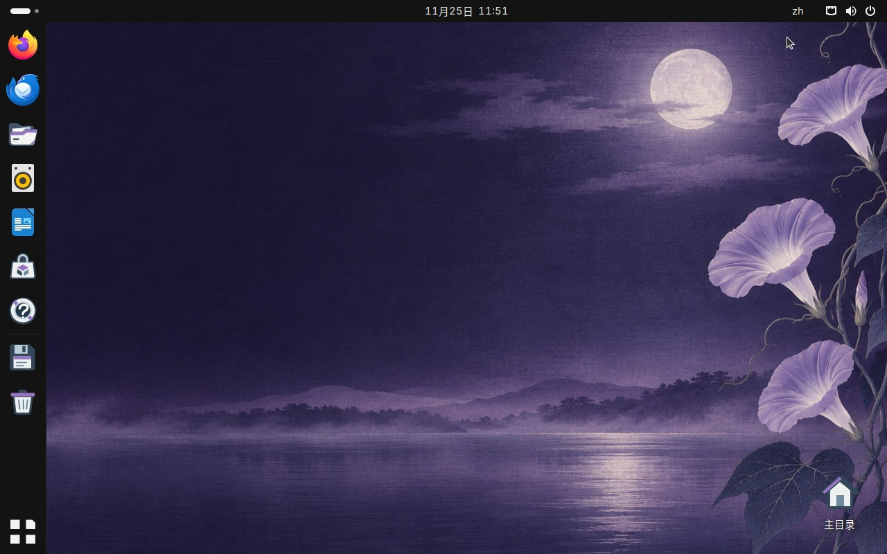

# AzusaLinux

AzusaLinux 是基于 Ubuntu 26.04 的个人桌面发行版，提供 GNOME 桌面、可换强调色的系统图标、Azusa 壁纸和中文输入。

[下载 0.1.3 RC2](https://github.com/dsyfb437/azusalinux/releases/tag/v0.1.3-rc2) · [全新安装](docs/installation.md) · [已有系统升级](docs/updates.md)

RC2 已在 VMware Workstation 上通过传统 BIOS 和开启 Secure Boot 的 UEFI 全新安装。初次体验建议使用空白虚拟机。

[开发文档](docs/README.md) · [问题反馈](https://github.com/dsyfb437/azusalinux/issues)

## 许可

本项目代码与原创吉祥物使用 MIT 许可。Ubuntu 和其他上游组件遵循各自的许可证。[吉祥物素材说明](branding/mascot/SOURCES.md)
