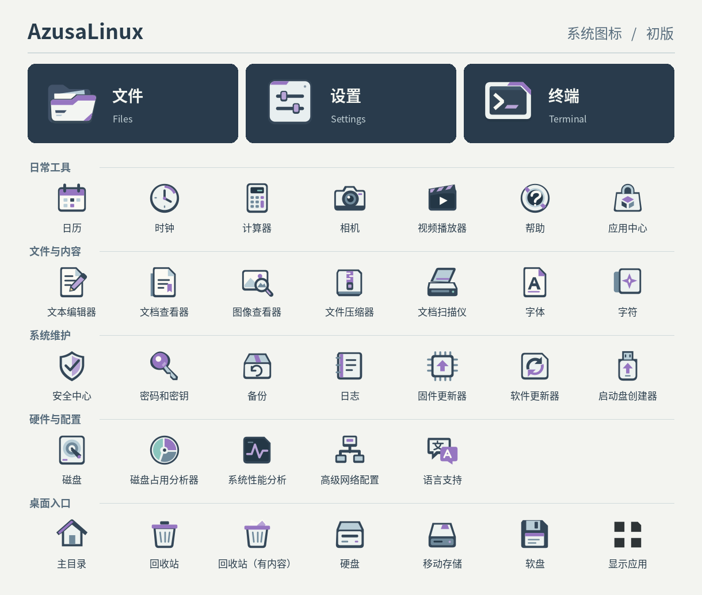
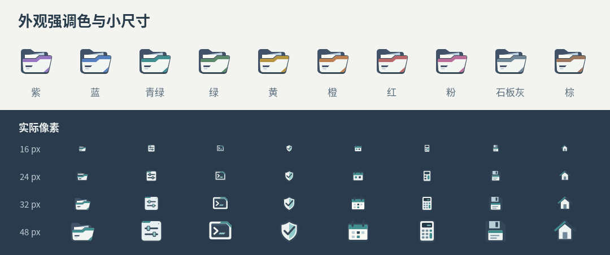

# AzusaLinux 系统图标

`azusa-icons` 0.1.3 为默认 GNOME 桌面提供 36 枚原创方形 SVG。造型借鉴什亭之匣的平板设备感。雾白外壳和石墨色屏面给图形定出边界，折角和短饰条承载用户选择的强调色。文件用翻盖与露出的纸页，主目录用屋顶与门洞，两者在 Dock 和桌面上仍有不同的轮廓。

## 覆盖清单

以 0.1.2 简体中文桌面实测的 42 个应用入口为基线。0.1.3 覆盖其中 29 项，另绘制 7 枚桌面与设备图标。

| 位置或用途 | 图标 |
| --- | --- |
| 常用入口 · 3 | 文件、设置、终端 |
| 日常工具 · 7 | 日历、时钟、计算器、相机、视频播放器、帮助、应用中心 |
| 文件与内容 · 7 | 文本编辑器、文档查看器、图像查看器、文件压缩器、文档扫描仪、字体、字符 |
| 系统维护 · 7 | 安全中心、密码和密钥、备份、日志、固件更新器、软件更新器、启动盘创建器 |
| 硬件与配置 · 5 | 磁盘、磁盘占用分析器、Sysprof 性能分析、高级网络配置、语言支持 |
| 桌面与设备 · 7 | 主目录、空回收站、有内容的回收站、硬盘、移动存储、软盘、显示应用 |

Firefox、Thunderbird、Rhythmbox、资源（Resources）、Remmina、Shotwell、Transmission 和 LibreOffice 的六个入口沿用原桌面中的图标来源。GNOME 的“系统”和“实用工具”文件夹自动组合其中应用的缩略图。Live 安装器继续使用发行版标志。

## 换色与小尺寸

安装图标包并登录 GNOME 后，在 **设置 → 外观 → 强调色** 中选择颜色。默认紫色，另有蓝、青绿、绿、黄、橙、红、粉、石板灰和棕色。饰条、部分功能图形和 Papirus 文件夹随之换色；“显示应用”按桌面前景色绘制。切换到其他图标主题后，桌面尊重用户的选择。再次选择 Azusa 主题会应用当前强调色。

文件、设置、终端、日历、计算器、文本编辑器、文档扫描仪和字体各有一份小尺寸稿，共用于 16、22 和 24 px。例如计算器在小尺寸保留显示屏和纵向运算键，设置则加宽滑轨和两个位置不同的滑块。下图的小尺寸样例按原始像素排布。

## 软件包与验证

SVG 母版按应用、地点、设备和操作分类。构建器从母版生成十种主题，继续从 Papirus-Dark、Papirus、Adwaita 和 hicolor 继承其他图标。扩展图标时使用桌面入口实际的 `Icon=` 值，保留原应用 ID。[SVG 源文件](../branding/icons/) · [主题生成器](../packaging/gen-icon-theme.py)

应用中心、固件更新器与安全中心的 Snap 启动器使用绝对图片路径。图标包从 Snap 导出的启动器生成同 ID 的主题入口，仅替换主段的图标字段。Snap 更新或移除入口时，系统服务重新同步；其他主题可回退到 Snap 当前的图片。[启动器同步实现](../packaging/azusa-snap-icons.py)

在已安装的 VMware 系统上，用 0.1.2 图标包升级验证了 42 个应用入口及 Dock 顺序。十种强调色均经过 GTK 图标查询，覆盖 16、24、32、48、64 px 和 1×、2× 缩放。另在“外观”页实测换色、重新登录、切换至 Adwaita 和恢复 Azusa。此版本的图标包完成了桌面验证，公开 ISO 的版本以发布页为准。
